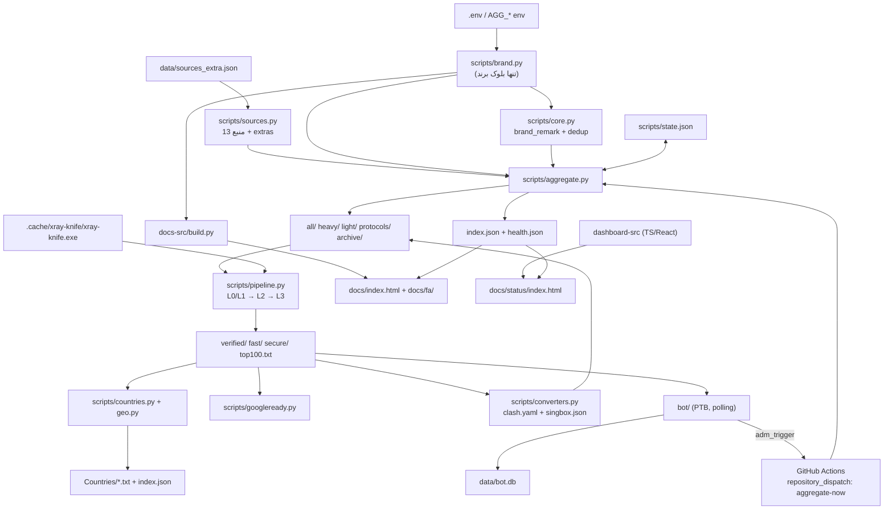

# معماری و نقشهٔ وابستگی‌های Free-v2ray-Configs

> این سند از روی **خودِ سورس** نوشته شده (نه از README)، تا پیش از هر تغییرِ برندینگ بتوانی ببینی هر فایل چه می‌کند، چه چیزی را می‌خواند و چه چیزی را می‌نویسد.
> تاریخ نگاشت: ۲۰۲۶-۱۱-۱۹ · حدود ۴٬۵۰۰ خط پایتون در `scripts/` + `bot/` + `docs-src/` و ~۱٬۵۰۰ خط TSX/TS در `dashboard-src/`.

---

## ۱) نقشهٔ فایل‌ها

### `scripts/` — موتور تولید و اعتبارسنجی
| فایل | نقش | می‌خواند | می‌نویسد |
|---|---|---|---|
| `brand.py` | **تنها بلوک برند**: `BRAND_CHANNEL`, `BRAND_NAME`, `BOT_NAME/HANDLE`, `GH_USER/REPO/BRANCH`, `CHANNEL_URL`, `SUPPORT_URL`, `BOT_URL`, `SITE_URL`, `COMMIT_NAME`, `GENERATOR`. همهٔ مقادیر با env (`AGG_*`) override می‌شوند. CLI: `--render`, `--check`, `--github-env`, `--json` | env | README×۴، `docs-src`…/`dashboard-src/src/brand.generated.ts` |
| `core.py` | موتور کانفیگ: dedup key، `is_dummy_config`، تشخیص کشور از ریمارک، **`brand_remark()`** با الگوی `{CC} {flag} ‹@brand› {tag}`، `protocol_of`، `extract_valid_lines`، هدر Hiddify، `shield_unsupported_runs`، base64 | `brand` | — |
| `sources.py` | فهرست منابع: `LIGHT_SOURCES` (۸) + `HEAVY_SOURCES` (۵) = `all_sources()`؛ منابع کاربر در `data/sources_extra.json` merge می‌شوند (`add/remove/list_extra_source`) | `data/sources_extra.json` | همان فایل (وقتی از ربات اضافه شود) |
| `aggregate.py` | **خط‌لولهٔ واکشی**: fetch همهٔ منابع → dedup (CDN-aware) → برندینگ → نوشتن سبدها | `sources`, `core`, `state`, `brand` | `all/`, `heavy/`, `light/`, `protocols/`, `archive/`, `index.json`, `health.json`, `state.json` |
| `pipeline.py` | آبشار تأیید: L0/L1 فیلتر → L2 reachability → L3 واقعی با xray-knife (پیش‌فرض ۳ دور) | `all/configs.txt` | `verified/`, `fast/`, `secure/`, `top100.txt`, `pipeline.json` |
| `filters.py` | یکتاسازی نقطهٔ پایانی + فیلتر ارزان بی‌شبکه | — | — |
| `reachability.py` | L2: TCP handshake | — | — |
| `realtest.py` | L3: آزمون واقعی پروکسی با `xray-knife` (`L3_XK_BIN` یا `PATH` یا `.cache/xray-knife/xray-knife.exe`) | باینری xray-knife | CSV موقت |
| `converters.py` | تبدیل هر سبد به `clash.yaml` و `singbox.json` | سبدها | همان‌ها |
| `countries.py` | گروه‌بندی `verified` بر اساس کشور → `Countries/*.txt` + `Countries/index.json` (اگر ورودی خالی باشد، فهرست را پاک می‌کند) | `verified/configs.txt`, GeoIP | `Countries/` |
| `geo.py` / `geoip_probe.py` | حل DNS + GeoIP با `maxminddb` (DB-IP Country Lite) | GeoIP DB | — |
| `googleready.py` | لایهٔ Google/CDN (`google/`) با همان realtest | `verified/configs.txt` | `google/` |
| `mihomo_compat.py` | ردِ خطوط مرگ‌آور برای mihomo | — | — |
| `validate.py` | دروازهٔ اعتبارسنجی خروجی‌ها (`--with-validate`) | سبدها | — |
| `lkg.py` | last-known-good: پشتیبان/بازیابی tierها وقتی دور شکست می‌خورد | tierها | tierها |
| `state.py` | حافظهٔ بین‌دوره‌ای: بازدهٔ یکتا، auto-disable منابع | `state.json` | `state.json` |
| `status.py` | وضعیتِ پایدار + قفل + heartbeat + انتشار روی شاخهٔ `state` (git plumbing)؛ `begin/stage/finish/report/heartbeat/offline/publish/pull/show/counts/incr` | `status.json` (local + remote) | شاخهٔ `state` |
| `outbox.py` *(در `bot/`)* | صفِ SQLite idempotent برای ارسالِ کانال: `enqueue/due/mark_sent/mark_failed/stats/seen/reset` + ledger با کلید `sha256(config)[:16]` + backoff ۵s→۳۰۰s (سقف ۲۰ تلاش) | `data/outbox.db` | همان |
| `run_all.py` | **هماهنگ‌کنندهٔ کل زنجیره** (brand check → aggregate → pipeline → google → docs). فلگ‌ها: `--out`, `--quick`, `--skip-fetch`, `--limit N`, `--rounds N`, `--with-validate`, `--with-tests` | — | همهٔ خروجی‌ها |
| `test_pipeline.py` | سوئیت تست‌های ناوردا | — | — |

### `bot/` — ربات تلگرام
| فایل | نقش |
|---|---|
| `main.py` | نقاط ورود (`python -X utf8 -m bot.main`): ساخت `Application`، ثبت هندلرها، `run_polling()`، گارد `BOT_TOKEN`؛ heartbeat ۶۰s، publish status ۳۰۰s، پیش‌بررسی ۴۰۹ با httpx، `bot_offline()` در `finally` |
| `outbox.py` | صفِ SQLite idempotent برای ارسالِ کانال (شرح در بالا) | `data/outbox.db` | همان |
| `config.py` | env: `BOT_TOKEN`, `OWNER_ID`, `CHANNEL_USERNAME` (پیش‌فرضِ هندلِ کانال؛ `brand.py` هم آن را override می‌خواند), `GITHUB_TOKEN`, `GH_OWNER`, `GH_REPO`, `BOT_DB`, `MINI_APP_URL` + مسیر `verified/`, `fast/`, `secure/` |
| `db.py` | SQLite (`data/bot.db`): جدول‌های `users` و `admins` |
| `keyboards.py` | منوهای اصلی/پروتکل/ادمین |
| `utils.py` | `load_configs(bucket)` از `verified|fast|secure` (`configs.txt`، در نبودش `configs_base64.txt`)، `filter_by_protocol/country`، `chunk_text` |
| `handlers/user.py` | `/start`، ۲۰ تای آخر، جست‌وجوی کشور، فیلتر پروتکل، تعداد (۱–۱۰۰) |
| `handlers/admin.py` | پنل ادمین: `adm_stats`, `adm_trigger`, `adm_broadcast`, `adm_addadmin/removeadmin`, `adm_sources`, `adm_addsource`, `adm_removesource` |

### `docs-src/` + `docs/` + `dashboard-src/`
- `docs-src/build.py` — رندر README×۴ (`.in`ها) + `docs/index.html`، `docs/fa/index.html`، `docs/status/`، `sitemap.xml`، `robots.txt`؛ `--check` دریفت را می‌گیرد.
- `docs-src/app.js.in` — داشبورد اصلی (EN/FA): در `localhost`/`127.0.0.1` داده را از همان origin می‌خواند (`LOCAL`, `getFile`, `urlOf`).
- `dashboard-src/` — اپ React/TS (Vite) صفحهٔ `/docs/status/`؛ `src/lib/fetchJson.ts` با `resolveBases()` در loopback از origin محلی، وگرنه raw/CDN. اسکریپت‌ها: `bundle` (parcel + html-inline + make-docs)، `typecheck`.
- `docs/miniapp.html` — داشبورد تلگرام (Mini App)؛ کارت «وضعیت سیستم» (`#sysBody`) با `renderSystem()/loadStatus()` که `status.json` را از شاخهٔ `state` می‌خواند (online، heartbeat، counts، وضعیت workflow، تأخیر).
- `assets/make_*.py` — تولید SVG/PNG‌های برند (علامت، social preview، promo، pipeline).
- `tools/graphify/build.py` — گراف کد (`graphify-out/`)؛ `graphify-out/GRAPH_REPORT.md` گزارش خوشه‌هاست.

### داده و گردش‌کار
- `.github/workflows/aggregate.yml` — cron `*/5` (یک cron، نه چهار) + `workflow_dispatch` + `repository_dispatch` (`aggregate-now`) + `push`; دروازهٔ تازگی ۱۳min؛ قفل/مالکیت روی شاخهٔ `state`؛ گام `Begin cycle` (id: cycle, rc=75 busy)؛ گام `Report cycle` (always); شرط‌های downstream gated on busy.
- `.github/workflows/live.yml` — برش ۲۵دقیقه‌ای ربات (cron `*/20`, timeout 32)؛ pull/publish runtime status.
- `data/bot.db` (sqlite ربات)، `data/sources_extra.json` (منابع افزوده‌شده از ربات)، `.env` (کلیدها).

---

## ۲) گراف رابطه

مسیرِ عملیاتی (`run_all.py`) همان ترتیبِ CI است:
`brand --check` → `aggregate.py` → `pipeline.py` → `googleready.py` → `docs-src/build.py`.

---

## ۳) نقاط ورود (چیزی که واقعاً اجرا می‌شود)

| نقطهٔ ورود | دستور |
|---|---|
| کل زنجیره | `python -X utf8 scripts/run_all.py` (یا `--limit 300 --rounds 1`) |
| فقط واکشی/برندینگ | `python -X utf8 scripts/aggregate.py` |
| فقط آبشار | `python -X utf8 scripts/pipeline.py all/configs.txt --out . --json pipeline.json --rounds 1` |
| Google tier | `python -X utf8 scripts/googleready.py` |
| برند | `python -X utf8 scripts/brand.py --render` / `--check` |
| مستندات | `python -X utf8 docs-src/build.py` / `--check` |
| ربات | `python -X utf8 -m bot.main` |
| هر دو سرویس محلی | `.\start-local.cmd` (وب‌سرور ۸۱۲۳ + ربات) |
| بستن نمونه‌های محلی | `.\stop-local.cmd` (فقط فرآیندهای همین مخزن) |

---

## ۴) منطق برنامه (خلاصهٔ اجرایی)

1. **واکشی**: `aggregate.py` هر منبع را با retry می‌گیرد (base64/plain/subscription) و `health.json` وضعیت هر منبع را می‌نویسد.
2. **پالایش و یکتاسازی**: `core._dedup_key` (CDN-aware)، حذف dummy/نامعتبر.
3. **برندینگ**: `core.brand_remark` روی هر خط: `{CC} {flag} | {BRAND_CHANNEL} | {tag}` — یعنی ریمارکِ منبع (شامل تبلیغ کانال رقیب) بازنویسی می‌شود.
4. **انتشار سبدها**: `all/`, `heavy/`, `light/`, `protocols/`, `archive/` + `clash.yaml`/`singbox.json` + `index.json`/`health.json`.
5. **آبشار تأیید**: L0/L1 بی‌شبکه → L2 TCP → L3 آزمون واقعی با xray-knife؛ `verified/` = عبورکرده از همهٔ دورها.
6. **کشورها**: `countries.py` آی‌پی `verified` را GeoIP می‌زند و `Countries/*.txt` می‌سازد (با verified خالی، فهرست پاک می‌شود).
7. **Google tier** روی `verified` و **مستندات** از `index.json`/`health.json`/`Countries`.
8. **ربات** همان فایل‌های روی دیسک (`verified/`, `fast/`, `secure/`) را به کاربر می‌دهد.
9. **CI** همان زنجیره را هر ۵ دقیقه اجرا و خروجی‌ها را کامیت می‌کند.

---

## ۵) پاسخ پرسش‌ها

### ۵.۱ آیا پروژه با ربات تلگرام کنترل می‌شود؟
**بله، ولی «کنترل عملیاتی محدود»، نه کنترل کامل خط لوله.**

| قابلیت | کد | نیازمندی / محدودیت |
|---|---|---|
| آمار (کاربران، تعداد verified) | `adm_stats` | — |
| **همهٔ دسته‌ها** (top100/verified/fast/secure/google/all/heavy/light) | `user.cat_selected` + `utils.load_configs` | داده از فایل‌های محلی؛ دستهٔ خالی پیام می‌دهد |
| فهرست/روشن‌وخاموش‌کردن همهٔ منابع (ثابت + اضافه‌شده) | `adm_sources` / `adm_source_toggle` → `sources.set_source_enabled` | وضعیت در `data/sources_extra.json` (`disabled`) |
| **افزودن منبع** (light/heavy) | `adm_addsource` → `sources.add_extra_source` | فقط در `data/sources_extra.json` همین ماشین ذخیره می‌شود |
| حذف منبع | `adm_source_remove` → `sources.remove_source` | اضافه‌شده = حذف کامل؛ ثابت = خاموش (چون در git است) |
| راهنمای معیار دسته‌ها | `adm_cats_help` | متن ثابت، مطابق `pipeline.py`/`googleready.py` |
| broadcast به کاربران ربات | `adm_broadcast` | به **کاربران ربات** پیام می‌دهد، نه کانال |
| افزودن/حذف ادمین | `adm_addadmin` / `adm_removeadmin` | فقط `OWNER_ID` |
| **اجرای به‌روزرسانی** | `adm_trigger` → `POST /repos/{owner}/{repo}/dispatches` (`aggregate-now`) | `GITHUB_TOKEN` + `GH_OWNER` + `GH_REPO`؛ خالی بودنشان → پیام خطای فارسی |
| اجرای خط لوله روی خودِ ماشین | ❌ وجود ندارد | ربات فقط dispatch می‌کند؛ pipeline را اجرا نمی‌کند |
| انتشار در کانال | ❌ وجود ندارد | `CHANNEL_USERNAME` در `bot/config.py` خوانده می‌شود ولی **هیچ‌جا استفاده نمی‌شود** |

### ۵.۲ آیا می‌شود برند خودم روی کانفیگ‌ها ست شود و در ربات/کانال خودم منتشر شود؟
**برند: بله، از پیش پیاده‌سازی شده و «تک‌منبع» است. انتشار در ربات: بله (با فایل‌های محلی). انتشار خودکار در کانال: نه، باید اضافه شود.**

- برند روی **هر کانفیگ** در مرحلهٔ `aggregate` زده می‌شود (`core.brand_remark`) و در همهٔ سبدها (`all/`, `verified/`, `Countries/`, `protocols/`) منتشر می‌شود؛ یعنی ربات هم همان خطوط برندخورده را می‌فرستد.
- تغییر برند = **یک بلوک**: ثابت‌های `scripts/brand.py` یا envهای `AGG_BRAND_CHANNEL`, `AGG_BRAND_NAME`, `AGG_BOT_NAME`, `AGG_GH_USER`, `AGG_GH_REPO`, `AGG_CHANNEL_URL`, `AGG_SUPPORT_URL`, `AGG_SITE_URL`, … سپس:
  `python -X utf8 scripts/brand.py --render` و `python -X utf8 docs-src/build.py` و در پایان `--check` هر دو.
- انتشار در **کانال**: هیچ کدی امروز پیام/فایل در کانال نمی‌گذارد. برای آن لازم است: (۱) ربات در کانال ادمین باشد، (۲) شناسهٔ کانال (`@…` یا `-100…`) در env، (۳) یک هندلر که فایل‌های `verified/*.txt` یا `index.json` را با `send_document` بفرستد و پس از `aggregate` صدا زده شود.
- انتشار در **ربات خودت**: فقط `BOT_TOKEN` و `OWNER_ID` را در `.env` عوض کن؛ ربات از همان `verified/` محلی می‌خواند. اگر ربات روی ماشین دیگری باشد، فایل‌های سبد باید همگام شوند (ربات خودش دانلود نمی‌کند).

### ۵.۳ کانفیگ‌های فعلی از کجا استخراج می‌شوند؟
از **۱۳ منبع فعال** در `scripts/sources.py` (۸ «سبک» + ۵ «انبوه») — همگی مخازن/سابسکریپشن‌های عمومی گیت‌هاب و مشابه. لیست ثابت است و منبع کاربر (از ربات) به آن merge می‌شود. وضعیت زندهٔ هر منبع (HTTP/تعداد/خطا/غیرفعال) در `health.json` منتشر می‌شود؛ `state.py` منبعی را که چند دور «۰ یکتا» بدهد خودکار غیرفعال می‌کند.

### ۵.۴ راه‌های افزودن/تعریف منبع
1. **دائمی و نسخه‌دار**: URL را در `LIGHT_SOURCES` یا `HEAVY_SOURCES` در `scripts/sources.py` بگذار. قاعدهٔ خودِ فایل: هر URL قبل از افزودن با درخواست واقعی تست و تعداد کانفیگش شمرده شود؛ عددِ مستندِ «تعداد منابع» در docstring هم باید به‌روز شود (تست روی آن قفل است).
2. **از داخل ربات** (فقط ادمین/مالک): پنل ادمین → «منابع و مدیریت» → روشن/خاموش یا حذف هر منبع، و «افزودن منبع» → `data/sources_extra.json` (merge در import). مناسب تست سریع؛ فقط روی همان ماشینی که `aggregate` اجرا می‌شود اثر دارد.
3. **PR به همین مخزن**: اگر می‌خواهی در CI هم لحاظ شود، تغییر `sources.py` باید کامیت شود.
4. **بازاجرا**: بعد از افزودن، یا `adm_trigger` (dispatch) یا محلی `python -X utf8 scripts/run_all.py --skip-fetch`… (برای منابع جدید باید fetch انجام شود، پس بدون `--skip-fetch`).

---

## ۶) وضعیت دادهٔ فعلی (برای بازبینی، نه تغییر)

- `all/configs.txt`: ۱۱٬۳۸۲ کانفیگ یکتا.
- `verified/`, `fast/`, `secure/`, `top100.txt`: **۰ کانفیگ** — نتیجهٔ اجرای محلی با `--rounds 3` (`pipeline.json`: `per_run_ok [0,0,156]`, stable 0).
- `Countries/index.json`: فهرست خالی (چون ورودی صفر است و `countries.py` عمداً فهرست را جارو می‌کند).
- ربات و داشبورد کار می‌کنند ولی تا وقتی یک دور موفق `pipeline` اجرا نشود، لیستشان خالی است.

---

## ۷) چک‌لیست پیش از تغییر برندینگ

| # | چه چیزی | کجا |
|---|---|---|
| ۱ | نام/هندل کانال، نام برند، لینک‌ها | `scripts/brand.py` (یا `AGG_*`) |
| ۲ | ریمارک هر کانفیگ | `core.brand_remark` (از `brand` تغذیه می‌شود) |
| ۳ | توکن/مالک/کانال ربات | `.env` (`BOT_TOKEN`, `OWNER_ID`, `CHANNEL_USERNAME`, `GITHUB_TOKEN`, `GH_OWNER`, `GH_REPO`) |
| ۴ | متن‌های فارسی ربات | `bot/handlers/*.py`, `bot/keyboards.py` |
| ۵ | لوگو/تصاویر/README | `assets/make_*.py` → `brand.py --render` → `docs-src/build.py` |
| ۶ | صفحهٔ status | `dashboard-src/src/brand.generated.ts` (تولیدی) |
| ۷ | بازتولید و گیت دریفت | `brand.py --check` + `docs-src/build.py --check` |

---

## ۸) اسناد عمیق‌تر
- `docs/project-analysis.md` — تحلیل کامل فایل‌به‌فایل (۲۱۶ خط).
- `docs/telegram-control.md` — کنترل از تلگرام.
- `graphify-out/GRAPH_REPORT.md` — خوشه‌های کد و گراف تولیدشده.
