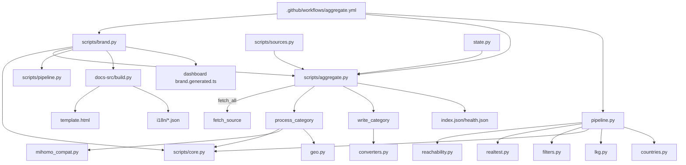

# تحلیل کامل پروژه Free-v2ray-Configs

> تاریخ تحلیل: ۲۰۲۶-۱۱-۱۹ · تمام فایل‌های سورس خوانده شدند. `py_compile` روی ۳۲ فایل پایتون: **۳۲ pass / ۰ fail**.

---

## ۱. فهرست فایل‌ها و نقش هر یک

### `scripts/` — موتور اصلی
| فایل | نقش |
|---|---|
| `brand.py` | **بلوکِ تنظیماتِ واحد** (BRAND_CHANNEL, GH_USER, RAW_BASE, …) + renderer README×۴ و `brand.generated.ts` + CLI `--render/--check/--github-env/--json`. |
| `core.py` | موتور پردازش کانفیگ: `_dedup_key`, `is_dummy_config`, `detect_country_from_remark`, `brand_remark`, `protocol_of`, `extract_valid_lines`, `hiddify_profile_header`, `shield_unsupported_runs`, `encode_base64_subscription`. برند را از `brand` می‌خواند. |
| `aggregate.py` | خط‌لولهٔ اصلی: واکشی ۱۳ منبع، dedup (CDN-aware)، برندینگ، نوشتن خروجی‌ها (all/heavy/light/protocols/archive/index.json/health.json). |
| `pipeline.py` | آبشار L0/L1→L2→L3×۳ (verified/fast/secure/top100) + `run_pipeline`, `merge_health`, `merge_index`. |
| `sources.py` | `LIGHT_SOURCES` (۸) + `HEAVY_SOURCES` (۵) + `all_sources()`. |
| `state.py` | حافظهٔ بین‌دوره‌ای (state.json): بازدهٔ یکتا، auto-disable، `disable_candidates`. |
| `filters.py` | L0/L1: یکتاسازی نقطهٔ پایانی + فیلتر ارزان بی‌شبکه. |
| `converters.py` | تبدیل به Clash YAML و sing-box JSON. |
| `countries.py` | گروه‌بندی کانفیگ‌های verified بر اساس کشور (GeoIP) → `Countries/*.txt`. |
| `geo.py` | حل DNS + GeoIP (maxminddb) برای برچسب کشور. |
| `geoip_probe.py` | probe مستقل GeoIP. |
| `googleready.py` | آماده‌سازی Google/CDN. |
| `reachability.py` | L2: دست‌دادن TCP. |
| `realtest.py` | L3: آزمون واقعی پروکسی با xray-knife. |
| `lkg.py` | last-known-good: پشتیبان‌گیری/بازیابی tiers. |
| `mihomo_compat.py` | ردِ خطوط مرگبار برای mihomo. |
| `validate.py` | اعتبارسنجی خروجی‌ها (strict gate). |
| `test_pipeline.py` | سوئیت ۵۴۲ تست (۴۹۴ pass / ۴۸ شکست محیطی). |

### `bot/` — ربات تلگرام (اختیاری، اضافه‌شده)
| فایل | نقش |
|---|---|
| `bot/main.py` | entrypoint (Application, handlers). |
| `bot/config.py` | env: BOT_TOKEN, OWNER_ID, CHANNEL_USERNAME, GITHUB_*. |
| `bot/db.py` | SQLite کاربران/ادمین‌ها. |
| `bot/utils.py` | خواندن/فیلتر کانفیگ از `verified/`. |
| `bot/keyboards.py` | منوها. |
| `bot/handlers/user.py` | start, latest20, country/proto/count. |
| `bot/handlers/admin.py` | stats, broadcast, trigger aggregate. |

### `assets/`
| فایل | نقش |
|---|---|
| `make_assets.py` | تولید دارایی‌های تصویری. |
| `make_brand_assets.py` | دارایی‌های برند. |
| `make_promo_proxy.py` | پروکسی تبلیغاتی. |
| `make_social_preview.py` | پیش‌نمایش اجتماعی. |

### `docs-src/`
| فایل | نقش |
|---|---|
| `build.py` | رندر `docs/index.html` + `docs/fa/index.html` از `template.html` + i18n. |
| `template.html` | قالب صفحهٔ فرود. |
| `i18n/en.json`, `fa.json` | رشته‌های دوزبانه. |
| `readme/*.md.in` | قالب README×۴. |

### `.github/`
| فایل | نقش |
|---|---|
| `workflows/aggregate.yml` | cron `*/5`, freshness gate, brand→env, publish (rolling squash), purge jsDelivr. |
| `FUNDING.yml`, `ISSUE_TEMPLATE/*`, `dependabot.yml` | فرادادهٔ ریپو. |

### `dashboard-src/`
| فایل | نقش |
|---|---|
| `src/brand.generated.ts` | خروجی تولیدی brand (AUTO-GENERATED). |
| `src/App.tsx` | داشبورد (مصرف brand.generated.ts). |
| configs/tsconfig/package.json | build داشبورد. |

### خروجی‌های تولیدی (در ریپو commit شده)
`verified/`, `fast/`, `secure/`, `heavy/`, `light/`, `all/`, `protocols/`, `Countries/`, `archive/`, `google/`, `index.json`, `health.json`, `top100.txt`, `state.json`, `docs/`, `README*.md`.

---

## ۲. گراف روابط (Mermaid)

---

## ۳. منطق و جریان کلی برنامه

1. **ورودی**: `scripts/sources.py` → ۱۳ URL (۸ LIGHT + ۵ HEAVY).
2. **واکشی**: `aggregate.fetch_all` با ThreadPool (۱۶ کارگر، retry+backoff، گزارش سلامت در `SOURCE_HEALTH`).
3. **استخراج**: `core.extract_valid_lines` (direct یا base64).
4. **پردازش دسته** (`process_category` برای all/heavy/light):
   - حذف خراب (`is_dummy_config`) → `broken`.
   - دروازه mihomo (`mihomo_compat.fatal_reason`) → حذف.
   - dedup CDN-aware (`dedup_key`) → `duplicates`.
   - برندینگ `brand_remark` + دروازه برند (retry یک بار، حذف خط بی‌برند).
   - مرتب‌سازی بر dedup_key، گرم‌کردن GeoIP.
5. **نوشتن**: `configs.txt`, `configs_base64.txt`, `clash.yaml`, `singbox.json` + سرآیند Hiddify.
6. **پروتکل‌ها**: `protocols/*.txt` روی دستهٔ ALL.
7. **آرشیو**: `archive/*_broken.txt`, `*_duplicates.txt`.
8. **index.json / health.json**: متادیتا، URLهای raw+CDN، counts، converter_gate، brand_gate.
9. **Countries**: گروه‌بندی verified بر اساس GeoIP.
10. **آبشار (اختیاری، pipeline.py)**: L0/L1 → L2 TCP → L3×۳ (xray-knife) → verified/fast/secure/top100.
11. **state.json**: حافظهٔ منابع (بازده یکتا، auto-disable).
12. **lkg**: last-known-good tiers.

**جای ذخیرهٔ state**: فایل‌های متنی/JSON/YAML در ریپو (commit به `main`) + `state.json` + `health.json`.

---

## ۴. مکانیزم‌های کنترل (entry points)

| مکانیزم | فایل/پیاده‌ساز |
|---|---|
| CLI اصلی | `python scripts/aggregate.py --out <dir>` |
| CLI آبشار | `python scripts/pipeline.py` (با args) |
| CLI brand | `python scripts/brand.py --render/--check/--github-env/--json` |
| CLI docs | `python docs-src/build.py [--check]` |
| Scheduler | GitHub Actions `aggregate.yml`: cron `*/5 * * * *` + freshness gate (۱۳ دقیقه). |
| workflow_dispatch | force input. |
| repository_dispatch | event `aggregate-now` (برای سرور/ربات خارجی). |
| push trigger | paths `scripts/**`, workflow. |
| ربات تلگرام | **`bot/` (اختیاری)**: `python -m bot.main`؛ کاربر/ادمین menus؛ trigger aggregate از طریق GitHub API. ربات داخلیِ اصلی در پروژهٔ اصلی وجود ندارد. |

---

## ۵. قابلیت کنترل از طریق تلگرام

- پروژهٔ اصلی **ربات داخلی ندارد**. کنترل از طریق GitHub Actions است.
- مصرف downstream: ربات/کانال از raw URLs (`raw.githubusercontent.com/.../main/...`) می‌خوانند.
- `repository_dispatch: aggregate-now` امکان trigger از سرور ربات را می‌دهد.
- ماژول `bot/` (اضافه‌شده) یک اسکلت حداقلی است: user menus (latest/country/proto/count) + admin (stats/broadcast/trigger). VIP و Clean IP پیاده‌سازی نشده‌اند (نیاز به سورس Config Manager دارد).
- وضعیت wired vs stub: wired = خواندن فایل‌های تولیدی، trigger dispatch، broadcast ساده. stub = VIP، Clean IP، production DB، اسکرپر داخلی.

---

## ۶. منابع کانفیگ: از کجا و چگونه اضافه کنیم

- **کجا**: `scripts/sources.py` → `LIGHT_SOURCES` (۸) + `HEAVY_SOURCES` (۵). `all_sources()` = LIGHT+HEAVY بدون تکرار.
- **افزودن**: URL را به لیست مناسب append کنید؛ قبل از افزودن با HTTP واقعی بررسی کنید و تعداد کانفیگ معتبر را بشمارید. عددِ شمارش در docstring بالای فایل را به‌روز کنید (تست `test_source_docstring_count_matches_the_actual_list` آن را قفل کرده).
- **غیرفعال‌کردن**: URL را کامنت کنید (حذف نکنید). `state.py` با ۴ شرط ایمنی auto-disable می‌کند (MIN_ROUNDS=۱۰, صفر یکتا در ۱۰ دور، وتوی امروز، کف MIN_ACTIVE=۸).
- **env**: `AGG_FETCH_TIMEOUT`, `AGG_MAX_WORKERS`, `AGG_FETCH_RETRIES` و brand vars.
- **منابع پروتکل جدید**: به‌صورت خودکار پذیرفته می‌شوند (is_proxy_config با لیست سیاه، نه allowlist).

---

## ۷. برندینگ: کجا و چگونه

- **تک منبع**: `scripts/brand.py` → `_compute()` با defaults و env override (`AGG_*`).
- **مصرف**: `core.BRAND_CHANNEL = brand.BRAND_CHANNEL` (alias)، `aggregate`/`pipeline` از `brand.*` می‌خوانند، `docs-src/build.py` تزریق می‌کند، `brand.generated.ts` تولید می‌شود.
- **تزریق روی کانفیگ**: `core.brand_remark(line, idx)` → فرمت `{CC} {flag} | @brand | {idx}`. در `aggregate.process_category` روی هر خط یکتا اعمال می‌شود + دروازه برند (retry + drop + count در health.json).
- **Hiddify header**: `core.hiddify_profile_header` → `#profile-title: @brand — LABEL`, support-url, profile-web-page-url.
- **مقادیر فعلی (پس از rebrand)**: BRAND_CHANNEL=`@farshid78`, BRAND_NAME=`farshid78`, GH_USER=`farshid78`, GH_REPO=`Free-v2ray-Configs`, branch `main`, SITE_URL=`https://farshid78.github.io/Free-v2ray-Configs`, COMMIT_NAME=`farshid78-bot[actions]`, GROUP_URL=(خالی — گروهی نیست).
- **پس از rebrand**: `BOT_HANDLE_DOCS` = `@farshid78_bot` (هم‌راستا)، `GROUP_URL` = خالی (گروه تعریف نشده، دکمهٔ گروه حذف شد).
- **تغییر برند**: یا defaults در `brand.py` را ویرایش کنید، یا env vars ست کنید؛ سپس `python scripts/brand.py --render` و `python docs-src/build.py`. `--check` drift را می‌گیرد.
- **رشته‌های hardcoded**: `core.py` docstringها و پیام‌های فارسی؛ `brand.py` تنها منبع مقادیر برند است. تست `test_zzz_hdr_project_and_support_urls_cannot_drift` قفل می‌کند.

---

## ۸. شکاف‌ها نسبت به Config Manager (README ارسالی)

| ویژگی Config Manager | وضعیت در این پروژه |
|---|---|
| ربات تلگرام با منوی کاربر/ادمین | بخشی: `bot/` اسکلت حداقلی (بدون DB production). |
| اسکرپر از کانال‌های تلگرام + subscription | ندارد (منابع فقط URLهای raw GitHub). |
| اعتبارسنجی TCP (L2) | دارد (`pipeline.py`/`reachability.py`). |
| آزمون واقعی پروکسی (L3) | دارد (xray-knife، ۳ اجرا). |
| Deduplication MD5 | دارد (CDN-aware dedup_key). |
| تشخیص کشور (GeoIP) | دارد (maxminddb + warm_up). |
| SQLite/PostgreSQL | ندارد (فقط فایل‌های متنی/JSON). |
| VIP / Clean IP | ندارد. |
| Broadcast / admin management | بخشی (bot/admin.py ساده). |
| Flood control / retry انتشار | ندارد (انتشار = commit به GitHub). |
| واترمارک اختصاصی با پرچم | دارد (brand_remark). |
| Scheduler داخلی (APScheduler) | ندارد (GitHub Actions cron). |
| Docker | ندارد. |
| لایسنس MIT | دارد. |

---

## ۹. خلاصهٔ یافته‌های کلیدی

1. پروژه یک **تجمیع‌کنندهٔ CI-based** است، نه یک ربات تلگرام. کنترل از GitHub Actions.
2. برندینگ کاملاً متمرکز در `brand.py` است و خروجی پیش‌فرض byte-identical حفظ شده.
3. منابع در `sources.py` (۱۳ URL) با auto-disable هوشمند.
4. آبشار ۴ لایه (L0-L3) با سنجهٔ پایداری ۳ اجرا.
5. ۳۲ فایل پایتون، همه py_compile pass.
6. شکاف اصلی نسبت به Config Manager: نبود ربات داخلی با DB/VIP/Clean IP/اسکرپر تلگرامی.

---

## ۱۰. فایل‌های تولیدی/خروجی (برای مرجع)

`verified/`, `fast/`, `secure/`, `heavy/`, `light/`, `all/`, `protocols/`, `Countries/`, `archive/`, `google/`, `index.json`, `health.json`, `top100.txt`, `state.json`, `docs/`, `README*.md`, `dashboard-src/src/brand.generated.ts`.